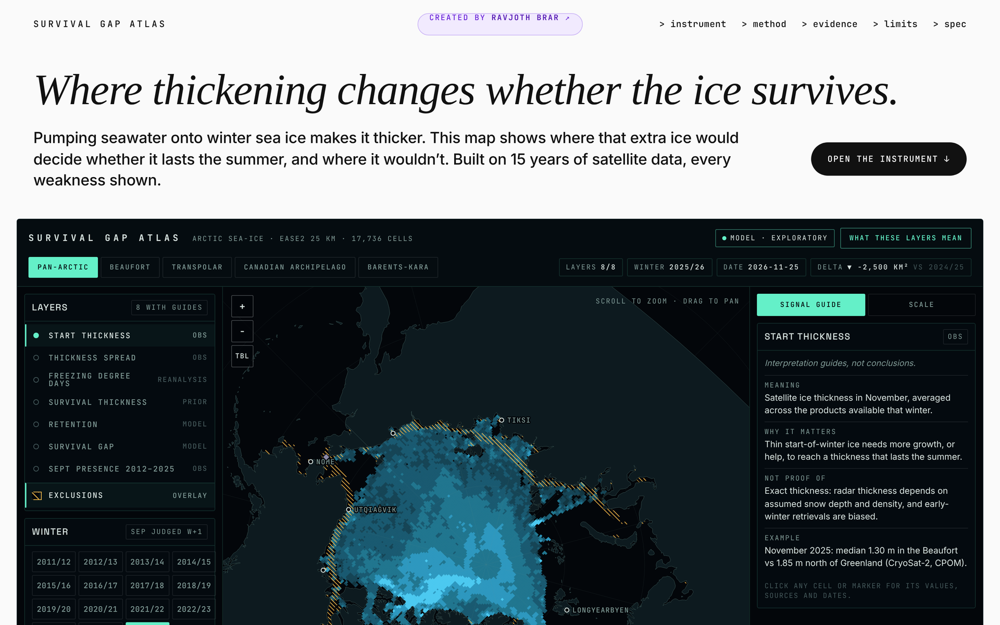
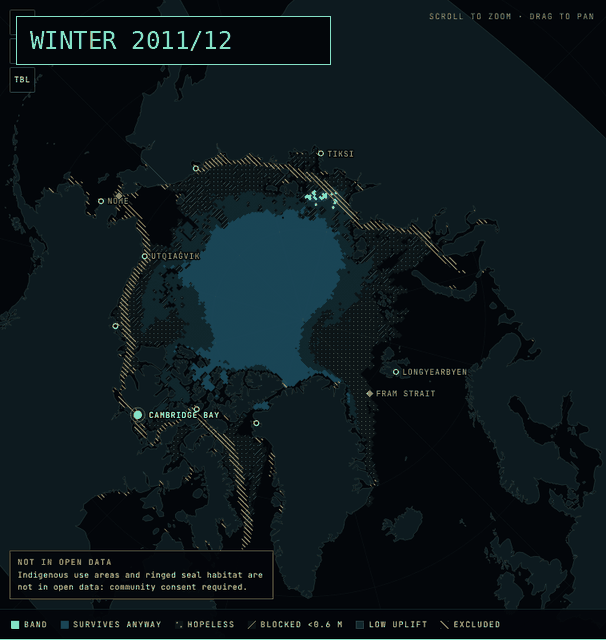
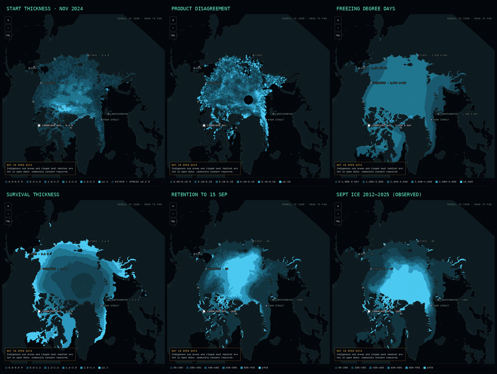
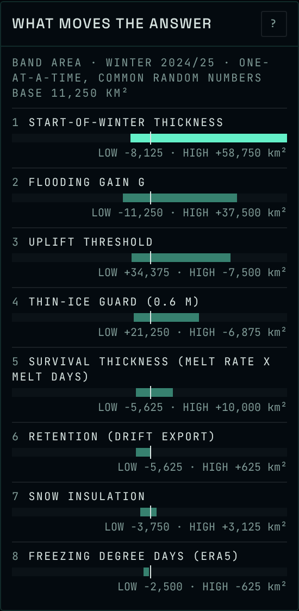
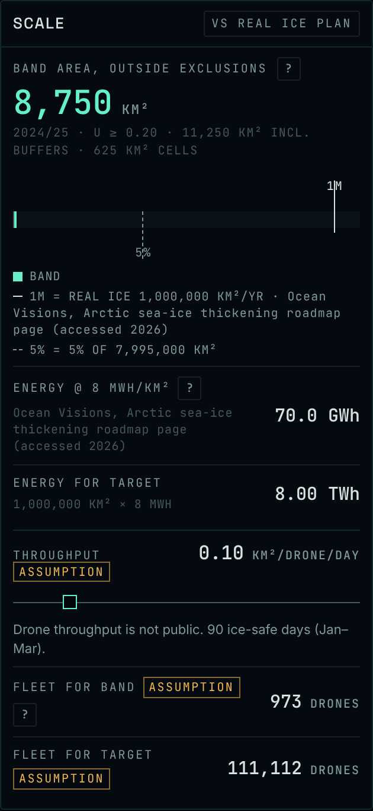
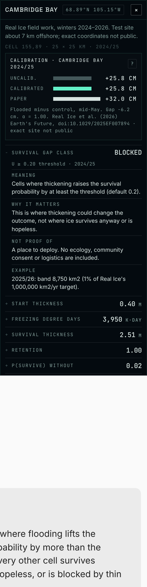
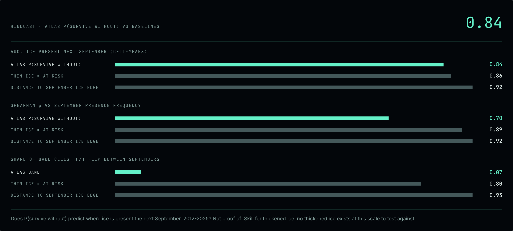
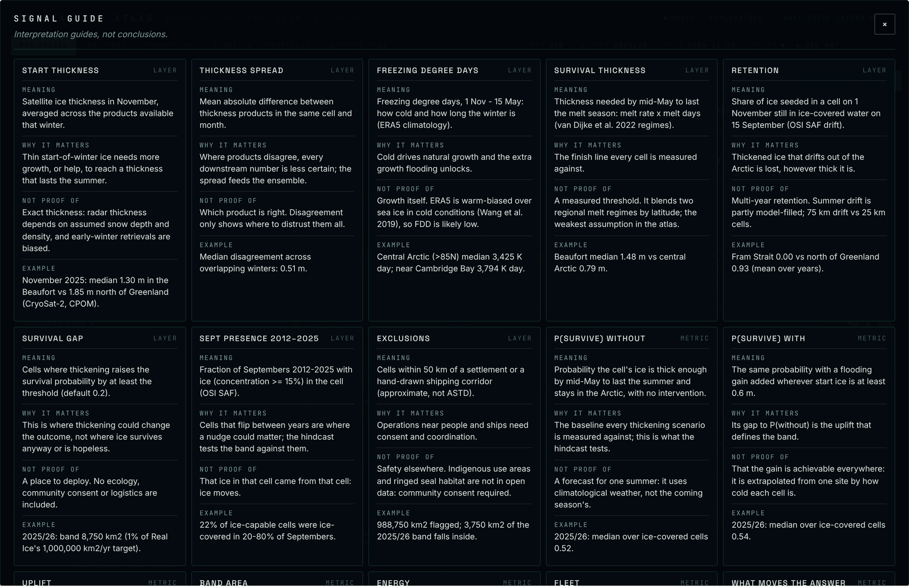
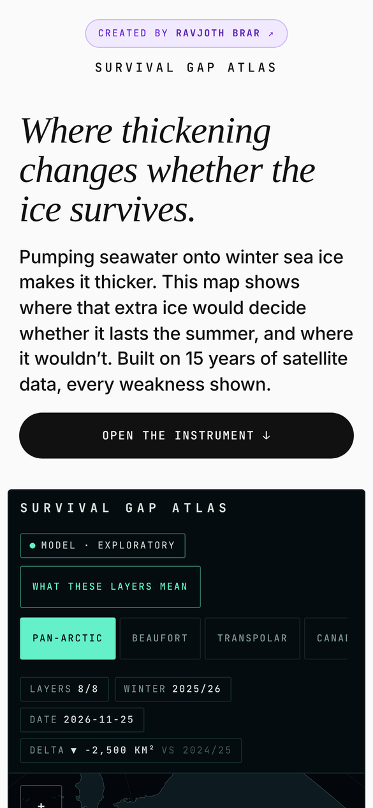
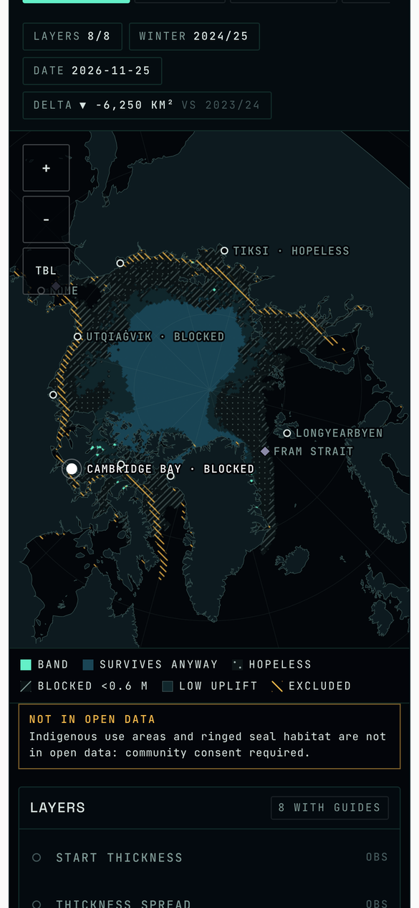

<div align="center">

# Survival Gap Atlas

**Where would thickening Arctic sea ice in winter change whether it survives the summer?**

[**Open the live atlas →**](https://ravjothbrar.github.io/real_ice/)


-03060A?style=flat-square&labelColor=0D1A1F&color=F2B84B)



</div>

## The idea

Pumping seawater onto winter sea ice makes it thicker. Real Ice has measured this at Cambridge Bay, Nunavut, where flooded ice was up to 32 cm thicker by mid-May. Their stated plan is 1,000,000 km² a year.

Thickening only matters where it changes the outcome. Ice that would survive the summer anyway doesn't need it, and ice too thin or drifting out of the Arctic can't be saved by it. This atlas maps the band in between, cell by cell, from open satellite data. It also shows the weakness of every layer.

<div align="center">

<br><sub>The band (mint) moves from winter to winter. Teal: survives anyway. Hatch: start ice under 0.6 m. Dots: hopeless.</sub>
</div>

## How it works

| Step | What happens | Data |
|---|---|---|
| **1. Start** | November thickness for every 25 km cell; disagreement between the products becomes uncertainty | CryoSat-2 (CPOM), ICESat-2 + SMOS/SMAP fusion (Petty et al.) |
| **2. Grow** | Stefan ice growth under snow, driven by freezing degree days | ERA5 |
| **3. Finish line** | Survival thickness = melt rate × melt days | van Dijke et al. (2022) melt regimes, ERA5 |
| **4. Stay** | Particles seeded in each cell on 1 Nov and tracked to 15 Sep | OSI SAF ice drift and concentration |
| **5. Decide** | 1,000 Monte Carlo draws per cell, with and without a flooding gain; uplift = P(with) − P(without) | Gain prior from the Cambridge Bay field result |



## What it found

- **The band is small.** In 2024/25, 11,250 km² of cells gain at least 0.2 in survival probability, about 1% of the 1,000,000 km²/yr plan. The largest band in 2011–2025 was 36,250 km² (2018/19).
- **November thickness decides most.** Adding 0.2 m to start-of-winter ice grows the band to 70,000 km², more than a 1.5× flooding gain does (48,750 km²).
- **The physics lands close to the field result.** With textbook constants, the model gives 25.8 cm flooded-minus-control at Cambridge Bay in 2024/25, against the paper's "up to 32 cm". No calibration value reaches 32 cm, and the atlas says so.

<table>
<tr>
<td width="50%"></td>
<td width="50%"><br></td>
</tr>
<tr>
<td><sub>WHAT MOVES THE ANSWER: band area with each input pushed low and high.</sub></td>
<td><sub>SCALE: band vs plan, energy at 8 MWh/km², fleet behind an explicit ASSUMPTION label. CELL: Cambridge Bay, model vs paper.</sub></td>
</tr>
</table>

## The honest test

The test was fixed before any tuning: predict whether each cell has ice the following September, over the Septembers 2012–2025 (189,265 cell-years).

| | Atlas P(survive without) | Thin ice = at risk | Distance to Sept ice edge |
|---|---|---|---|
| AUC | 0.843 | 0.862 | **0.918** |
| Spearman vs presence frequency | 0.701 | 0.889 | **0.917** |

**It does not beat either baseline.** The gap to the ice-edge baseline is significant; the 95% bootstrap interval of the AUC difference is −0.105 to −0.038.

Post-hoc diagnosis, labelled as such:
- The growth physics alone scores **0.931**, which beats both baselines.
- Multiplying by drift retention pulls it down. Retention asks whether *this ice* stays in the Arctic; the test asks whether *the cell* has ice.
- A climatology of past Septembers scores 0.956, better than everything here.



## Every layer shows its weakness

Each layer and metric carries four lines: **Meaning / Why it matters / Not proof of / Example**, and the example is always a real number. Clicking any cell shows its value, source, date and uncertainty.



<table>
<tr>
<td width="50%" align="center"></td>
<td width="50%" align="center"></td>
</tr>
</table>

## What it is not

- **Not a siting tool.** It has no ecology, logistics or community input. Indigenous use areas and ringed seal habitat are not in open data; the map says so on screen.
- **Not proof thickening works, or that it doesn't.** The gain prior comes from one 1 km site over one winter, extrapolated by how cold each cell is.
- **Not new science.** It is an open explainer of public data and published priors. Its limits are listed in [`ASSUMPTIONS.md`](ASSUMPTIONS.md), and every number in [`RESULTS.md`](RESULTS.md) has the command that produced it.

## Run it

```bash
make setup && make test                              # Python deps, 78 tests
python -m pipeline.growth                            # Cambridge Bay calibration
python -m eval.hindcast 400 && python -m eval.diagnose
python -m pipeline.sensitivity 2024
python -m pipeline.provenance && python -m pipeline.export   # -> web/public/data (3.4 MB)
cd web && npm ci && npm run dev                      # http://localhost:5173
```

```bash
python cli/atlas.py band --winter 2024 --threshold 0.2
python cli/atlas.py cell 69.05N -105.10E
python cli/atlas.py scale --km2 1000000 --throughput 0.1
```

The fetchers (`pipeline/fetch/`) cache everything under `data/raw/`, identify themselves, rate-limit and never re-download. `npm run build:single` writes one self-contained `index.html` (4.5 MB). Pushing to `main` deploys to GitHub Pages.

```
pipeline/   grid · thickness · climate · retention · growth · survival · sensitivity · export
eval/       labels.csv (25 literature labels) · hindcast · diagnose · tests/
web/        Vite + TypeScript · d3-geo polar stereographic · canvas cells · no framework
```

## Data and credit

- **IS2SMGPSIT-V1**, daily 25 km ICESat-2 + SMOS/SMAP sea-ice thickness: **Petty, Cardinale, Tsamados, Gregory, Cabaj**. [doi:10.5281/zenodo.22147361](https://doi.org/10.5281/zenodo.22147361), CC-BY-4.0.
- **CPOM CryoSat-2** sea-ice thickness, UCL.
- **OSI SAF** sea-ice concentration and drift. Copyright EUMETSAT.
- **ERA5** via Google ARCO-ERA5 (Copernicus Climate Change Service) · **PIOMAS** v2.1 (UW APL) · **Natural Earth** · **GEBCO**.
- Field result: Real Ice et al. (2026), *Earth's Future*, [doi:10.1029/2025EF007894](https://doi.org/10.1029/2025EF007894). Scale numbers: Ocean Visions roadmap.

Licences, checksums and access dates are in [`data/PROVENANCE.json`](data/PROVENANCE.json).

<div align="center">
<br>
<sub>Created by <a href="https://ravjothbrar.com"><b>Ravjoth Brar</b></a></sub>
</div>
